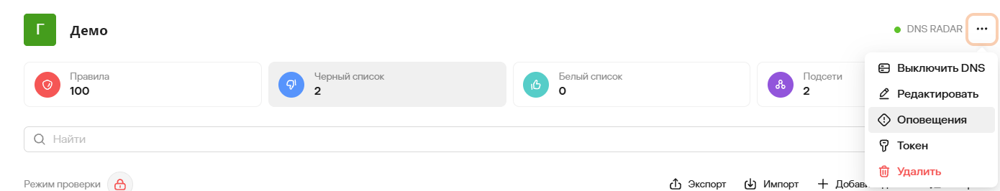
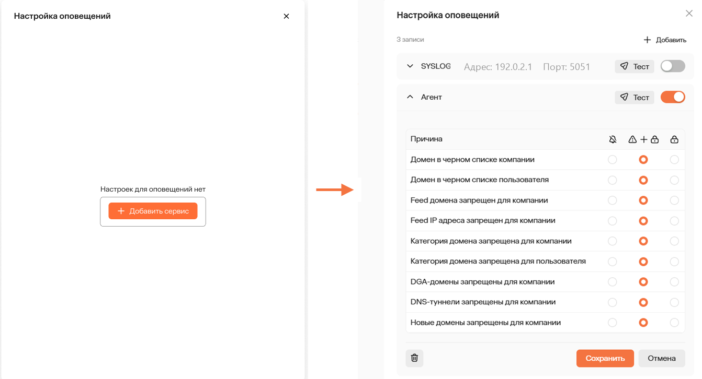
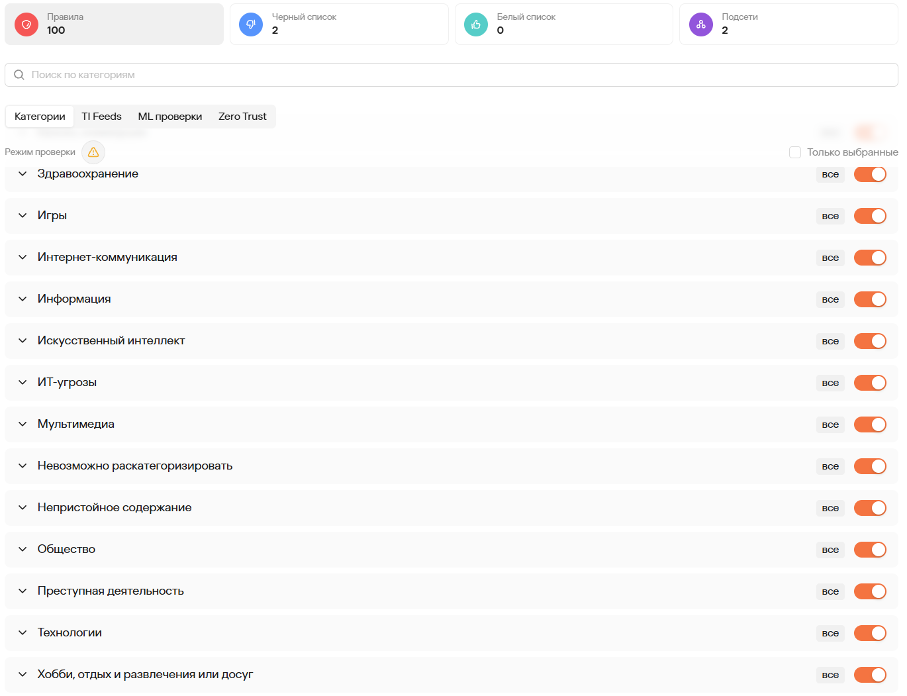
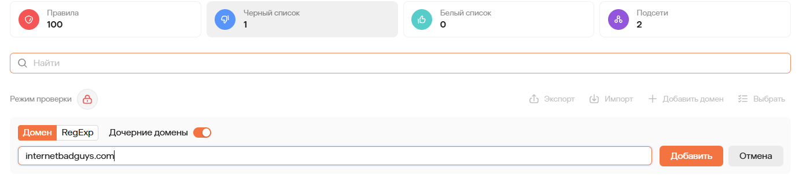
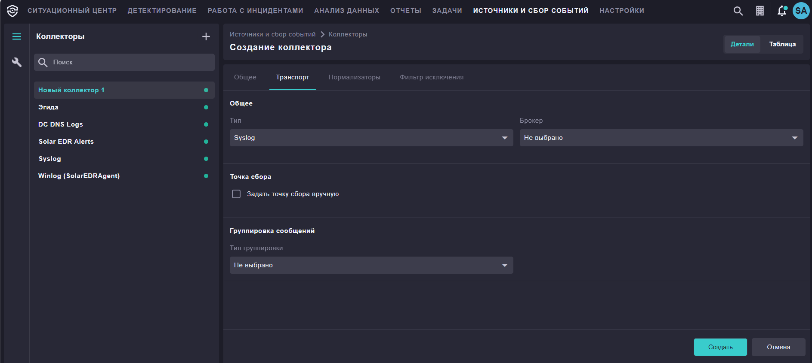
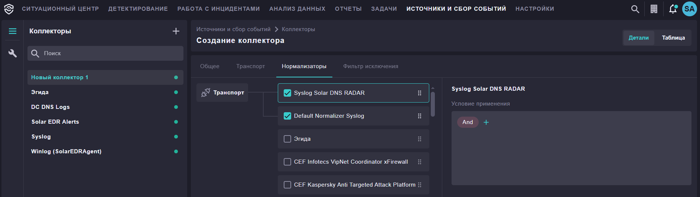
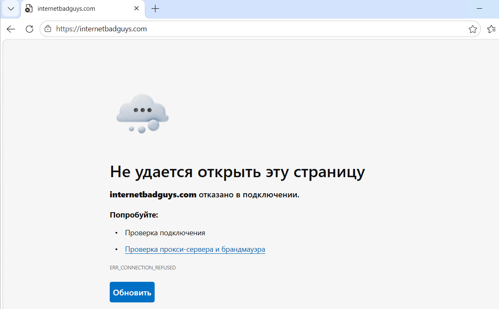
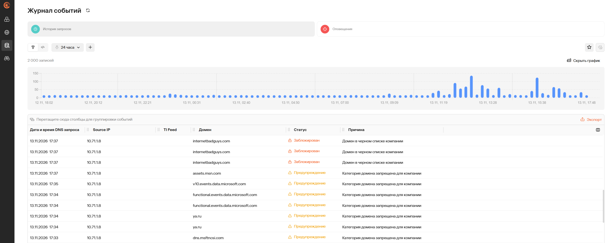
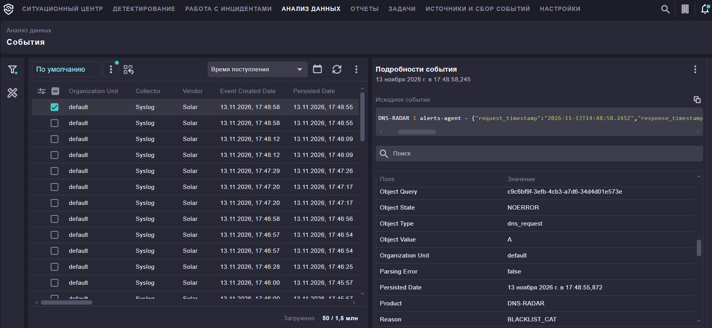

# Интеграция Solar DNS RADAR и Solar SIEM

Solar DNS RADAR поддерживает три варианта развёртывания:

- **Облачный (MSS)** — локальные компоненты не разворачиваются: DNS-серверы компании направляют запросы на публичные proxy-серверы DNS RADAR, которые выполняют фильтрацию;
- **Гибридный (SaaS)** — в сети заказчика разворачивается локальный модуль (DNS-proxy), который фильтрует запросы и синхронизируется с облачным центром управления и базами угроз;
- **Локальный (on-premise)** — полностью автономная установка на мощностях заказчика (закрытый контур).

В данной статье описан **<u>гибридный вариант развёртывания (SaaS)</u>** Solar DNS RADAR с [<u>установкой proxy-сервера сбоку</u>](#proxy-sboku), настройка [<u>сервиса alerts-agent</u>](#alerts-agent) и включение [<u>оповещений для агента</u>](#agent-notifications), который обеспечивает пересылку событий в Solar SIEM по протоколу syslog.

!!! note
    Локальный proxy-сервер (варианты установки приведены в разделе ниже) фильтрует DNS-запросы по правилам платформы (чёрный/белый списки, категории, фиды, ML).

## 1. Варианты установки proxy-сервера DNS RADAR

- [<u>**Прокси за DNS-сервером заказчика**</u>](#proxy-za-dns) — DNS-сервер заказчика пересылает запросы на прокси; во внешний мир запросы уходят с EDNS-заголовками (ECS) — если поддержка ECS включена на DNS-сервере (см. настройки ниже). Применяется на любых вариантах развёртывания: on-premise, гибридном, облачном.
- [<u>**Прокси сбоку**</u>](#proxy-sboku) — на прокси перенаправляются запросы только части АРМов (настройка DNS передаётся по DHCP). Применим для on-premise и гибридного вариантов. **Этот вариант с модификацией (DNS-пересыльщик перед прокси) — реализован в настоящей инструкции (разделы 2–7).**
- [<u>**Прокси перед DNS-сервером заказчика**</u>](#proxy-pered-dns) — запросы всех АРМов и серверов идут через прокси. Применим для on-premise и гибридного вариантов.

---

<a id="proxy-za-dns"></a>
**Прокси за DNS-сервером заказчика.**

---

Все клиенты обращаются к DNS-серверу заказчика, который пересылает запросы на прокси:

```text {.no-copy}
АРМ → DNS-сервер заказчика → прокси RADAR → рекурсивный DNS → интернет
```

Настройки DNS-сервера заказчика:

1. условные пересылки (forwarders) — только на IP прокси;
2. локальные зоны обслуживаются сервером напрямую, минуя прокси;
3. включить EDNS Client Subnet (ECS) — иначе прокси видит IP DNS-сервера вместо IP клиента;
4. DHCP раздаёт клиентам адрес DNS-сервера заказчика.

!!! note
    В облачном варианте развёртывания роль прокси выполняют публичные серверы DNS RADAR — они указываются как рекурсивные (forwarders) на DNS-серверах заказчика напрямую.

---

<a id="proxy-sboku"></a>
**Прокси сбоку.**

---

Прокси стоит параллельно DNS-серверу заказчика; на прокси смотрят только выбранные АРМы (адрес DNS раздаётся по DHCP):

```text {.no-copy}
выбранные АРМ → прокси RADAR → DNS-сервер заказчика → интернет
остальные АРМ → DNS-сервер заказчика
```

- upstreams прокси — DNS-серверы заказчика;
- гранулярность по хостам достигается настройкой DHCP (какие клиенты получают адрес прокси).

!!! note
    **В настоящей инструкции реализован этот вариант с модификацией** (разделы 2–7): вместо раздачи IP прокси по DHCP между выбранными АРМами и прокси разворачивается выделенный DNS-пересыльщик (dnsmasq, раздел 3). Тестовые АРМы получают адрес пересыльщика как обычный DNS-сервер. Включение фильтрации для хоста сводится к смене адреса DNS.

---

<a id="proxy-pered-dns"></a>
**Прокси перед DNS-сервером заказчика.**

---

Прокси встаёт в разрыв перед DNS-сервером: запросы всех АРМов и серверов идут через прокси:

```text {.no-copy}
все АРМ и серверы → прокси RADAR → DNS-сервер заказчика → интернет
```

- DHCP раздаёт клиентам адрес прокси (вместо адреса DNS-сервера);
- upstreams прокси — DNS-сервер заказчика.

## 2. Установка прокси

Требуется Docker. Образы прокси и alerts-agent распространяются через закрытый реестр контейнеров вендора — доступ к нему выдаётся вендором при подключении.

Создать каталог, например `/opt/dns-proxy` и файл `compose.yaml` (службу `alerts-agent` добавим на шаге 4):

```yaml
services:
  proxy:
    container_name: proxy
    image: registry.data.rt-solar.ru/4rays/secdns/proxy:v<версия>-public
    command: serve -c /config/proxy.pkl
    volumes:
      - "./proxy.pkl:/config/proxy.pkl:ro"
    network_mode: host
    restart: unless-stopped
    ulimits:
      nofile:
        soft: "65536"
        hard: "65536"
```

Создать `/opt/dns-proxy/proxy.pkl`:

```pkl
amends "../pkl/config.pkl"

debug = false
log_level = "info"

proxy_id = "<уникальный-id-прокси>"
build_version = "<актуальная версия>"
jwt = "<токен Control Center>"

health_server {
  host = "127.0.0.1"
  port = "82"
}

server {
  port = "53"
  monitor_port = "9102"
  amount_sockets = 4
  amount_ml_models = 1

  is_refused_on_not_found = false
  check_google_zip_net_for_tunnel = true

  private_addresses_ipv4 = List()
  private_addresses_ipv6 = List()

  forward {
            upstreams = List("<корпоративный-dns>:53")
    dns_client_read_timeout  = 10
    dns_client_write_timeout = 10
  }

  mlWhiteListSettings {
    domains = List("1e100.net", "in-addr.arpa")
  }

  cache {
    ttl = 30
  }

  rate_limiter {
    cache_size = 2097152
    record_ttl_sec = 60
    rps_by_client = 1000
    burst = 2000
  }

  sync_state {
    service_url = "grpc-sync-state.stage.secdns.envs.4rays.private:443"
    tls_enabled = true
  }

  sync_logs {
    service_url = "grpc-sync-logs.stage.secdns.envs.4rays.private:443"
    tls_enabled = true
  }

  clientDomainManager {
    threshold_unique_subdomains = 8
    ttl_window = 300
    clean_internval = 60
  }
}
```

Ключевые поля:

| Группа | Опция | Назначение |
|------|------|------------|
| — | `proxy_id` | идентификатор прокси (выдаётся вместе с JWT) |
| — | `build_version` | версия сборки образа — обязателен, должен совпадать с версией образа (например, `"3.3.16x-public"`) |
| — | `jwt` | токен подключения к Control Center |
| `server` | `port` | порт прослушивания DNS-запросов |
| `forward` | `upstreams` | корпоративные DNS |
| `mlWhiteListSettings` | `domains` | домены, исключённые из ML-анализа |
| `cache` | `ttl` | время кэширования ответов, сек |
| `rate_limiter` | — | ограничение частоты запросов с одного клиента (`rps_by_client`, `burst`) |
| `clientDomainManager` | — | детект DNS-туннелей: порог уникальных поддоменов (`threshold_unique_subdomains`) за окно `ttl_window` |
| `sync_state` / `sync_logs` | `service_url`/ `tls_enabled` | облако DNS RADAR: синхронизация правил и отправка журнала запросов |

## 3. DNS-пересыльщик (на примере dnsmasq)

В описываемой схеме между АРМами и прокси развёрнут DNS-пересыльщик: внешние запросы он отправляет на прокси RADAR. Для этого Тестовым АРМам указывается адрес пересыльщика как DNS-сервер.

Пересылку рассмотрим на примере использования dnsmasq.

Для настройки понадобится:

- пакет **dnsmasq**;
- **IP-адрес прокси** DNS RADAR — он станет единственным маршрутом `server=` (хост, где развёрнут прокси, порт `53`);
- **имена сетевых интерфейсов** хоста пересыльщика — если нужно явно ограничить прослушивание (`interface=`, `bind-interfaces`); без них dnsmasq слушает все интерфейсы;
- опционально — **локальные записи зоны** (`host-record` / `ptr-record`), если пересыльщик должен сам отвечать за отдельные имена.

Пример конфигурации `/etc/dnsmasq.d/radar.conf` (базовый `/etc/dnsmasq.conf` остаётся штатным):

```conf
# Маршруты пересылки
no-resolv
server=<ip-прокси>

# EDNS Client Subnet: передавать адрес клиента на прокси (32/128 — полный IPv4/IPv6)
add-subnet=32,128

# Журнал запросов
log-queries
```

Ключевые моменты:

- `no-resolv` — не использовать адреса из `/etc/resolv.conf`: апстримы задаются только директивой `server=`;
- `server=<ip-прокси>` — маршрут по умолчанию: все запросы пересыльщик отправляет на прокси RADAR;
- `log-queries` — журнал запросов с адресом источника (`query[A] example.com from <ip-АРМ>`).

После изменения конфигурации выполняем: `dnsmasq --test` (проверка синтаксиса) и `systemctl restart dnsmasq`.

!!! note
    Чтобы в Solar DNS RADAR был виден ip хоста, отправляющего запрос, должна быть задана опция `add-subnet=32,128`. Тогда каждый запрос уходит на прокси с EDNS-опцией (ECS), содержащей адрес АРМа: в RADAR он отображается в карточке события в поле **«EDNS подсеть клиента»**. Без этой опции источником всех событий будет адрес пересыльщика.

<a id="alerts-agent"></a>

## 4. Установка alerts-agent и пересылка по протоколу syslog в SIEM

**alerts-agent** добавляется второй службой в тот же файл `compose.yaml`, где находится `proxy`, на том же уровне вложенности (в примере это `/opt/dns-proxy/compose.yaml`):

```yaml
  alerts-agent:
    container_name: alerts-agent
    image: registry.data.rt-solar.ru/4rays/secdns/alerts-agent:v<версия>-public
    network_mode: host
    restart: unless-stopped
    environment:
      - SYSLOG_AGENT_TRANSPORT_ADDRESS=<адрес облака DNS RADAR>:443
      - SYSLOG_AGENT_TRANSPORT_TLS_ENABLED=true
      - SYSLOG_AGENT_TRANSPORT_TOKEN=<jwt>
      - SYSLOG_AGENT_SYSLOG_SERVERS=udp://<адрес-коллектора-siem>:5051
    ulimits:
      nofile:
        soft: "65536"
        hard: "65536"
```

Переменные окружения:

| Переменная | Назначение |
|------|------|
| `SYSLOG_AGENT_TRANSPORT_ADDRESS` | облако DNS RADAR (`sync-alerts`): агент подключается наружу по TLS, входящие порты не требуются |
| `SYSLOG_AGENT_TRANSPORT_TOKEN` | тот же токен, что в `proxy.pkl` |
| `SYSLOG_AGENT_SYSLOG_SERVERS` | приёмник syslog в SIEM: адрес коллектора и порт |

Агент шлёт события с IP хоста (`network_mode: host`). В SIEM источником будет этот адрес.

!!! note
    **5051 — порт syslog-коллектора SIEM по умолчанию**, если для точки сбора не задан переопределённый порт.

## 5. Настройка правил и оповещений в DNS RADAR

<a id="agent-notifications"></a>

### Оповещения для агента

Чтобы события о срабатываниях правил попадали в alerts-agent, в консоли DNS RADAR нужно создать правило оповещений:

- Перейти в **Компания** → меню **«...»** → **Оповещения**.



- В окне «Настройка оповещений» нажать **Добавить сервис** и выбрать тип доставки **Агент** — дополнительные параметры (IP, порты не задаются, агент сам подключается к облаку по HTTPS. Настраивается в `compose.yaml` на хосте с прокси). Затем для сервиса агента выбрать **Причины** оповещений — например, «Домен в черном списке компании» — и режим: **Оповещать при блокировке** или **Оповещать при блокировке и обнаружении**.



- Для проверки нажать **Тест** — придёт пробное уведомление; отправка включается переключателем рядом с правилом.

Агент принимает уведомления по защищённому протоколу (VPN-туннель не требуется) и пересылает их по syslog в SIEM. Без созданного правила оповещений события в SIEM не доставляются.

### Правила фильтрации

Правила создаются в консоли DNS RADAR в разделе **Правила** (уровень компании/тенанта). Сводка по активным правилам выводится карточками: **Правила**, **Чёрный список**, **Белый список**, **Подсети**.



Основные инструменты раздела:

- **Категории** — готовые группы ресурсов (ИТ-угрозы, Непристойное содержание, Мультимедиа и т.д.). Категория или отдельная группа включается переключателем; режим проверки (блокировка/предупреждение) задаётся рядом;
- **TI Feeds** — подключаемые каналы данных об угрозах;
- **ML-проверки** и **Zero Trust** — дополнительные механизмы анализа (новые/малоизвестные домены).

### Чёрный список

Самый быстрый способ проверить фильтрацию — добавить домен в **Чёрный список**:

- Открыть вкладку **Чёрный список** и нажать **Добавить домен**.
- Указать домен (например, `internetbadguys.com`) и выбрать тип записи `Domain`; поддерживается также `RegExp`.
- Опция **«Дочерние домены»** распространяет правило на все поддомены.
- Выбрать режим: **Блокировать** или **Предупреждать**.



Список можно переносить между инсталляциями кнопками **Экспорт**/**Импорт** (JSON).

!!! note
    Правила действуют на всю компанию (тенант). Гранулярность по хостам достигается только подсетями: раздел **Подсети** позволяет выделить группу адресов, а отдельные правила — через отдельные тенанты.

!!! note
    Порядок применения: сначала проверяется **Белый список** (разрешает в обход остальных правил), затем **Чёрный список**, затем категории, фиды и ML.

## 6. Настройка коллектора в SIEM

- Перейти на вкладку **Источники и сбор событий → Коллекторы** и создать коллектор с типом **Syslog** (по дефолту используется порт 5051):



- На вкладке **Нормализаторы** включить нормализатор **Syslog Solar DNS RADAR** (поставляется в комплекте SIEM). Нормализатор должен располагаться выше `Default Normalizer Syslog`.



## 7. Запуск и проверка

Команды выполняются на хосте, где поднят прокси (раздел 2):

```bash
cd /opt/dns-proxy
docker compose up -d
docker compose logs -f
```

В логах при успешном старте обоих контейнеров должны отсутствовать ошибки.

- Убедиться, что тестовый домен добавлен в **Чёрный список** (см. раздел 5). Для теста используем домен `internetbadguys.com`. Прокси забирает правило автоматически (обычно в течение минуты).

- Открыть `internetbadguys.com` в браузере на клиенте — соединение отклоняется:



- Проверить доставку событий: запись в **Журнале событий** RADAR и событие в SIEM.

Пример срабатывания чёрного списка в **Журнале событий** RADAR: запросы к `internetbadguys.com` со статусом **Заблокирован**, причина — «Домен в черном списке компании»:



Событие о блокировке, доставленное alerts-agent в SIEM, причина `BLACKLIST_CAT` — нормализатор **Syslog Solar DNS RADAR** разобрал исходное syslog-сообщение в поля:


