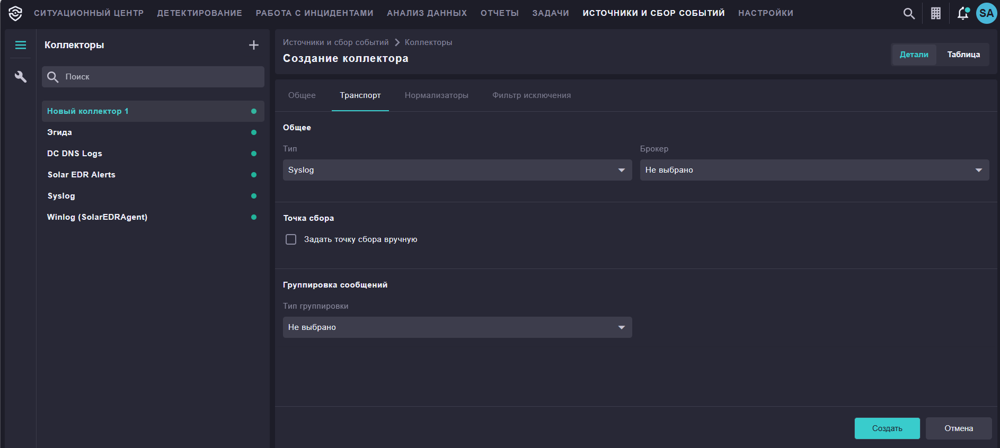
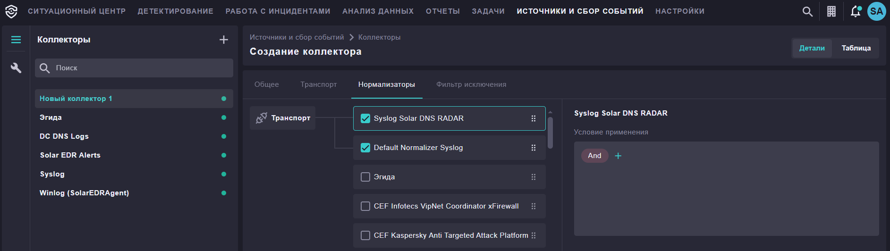
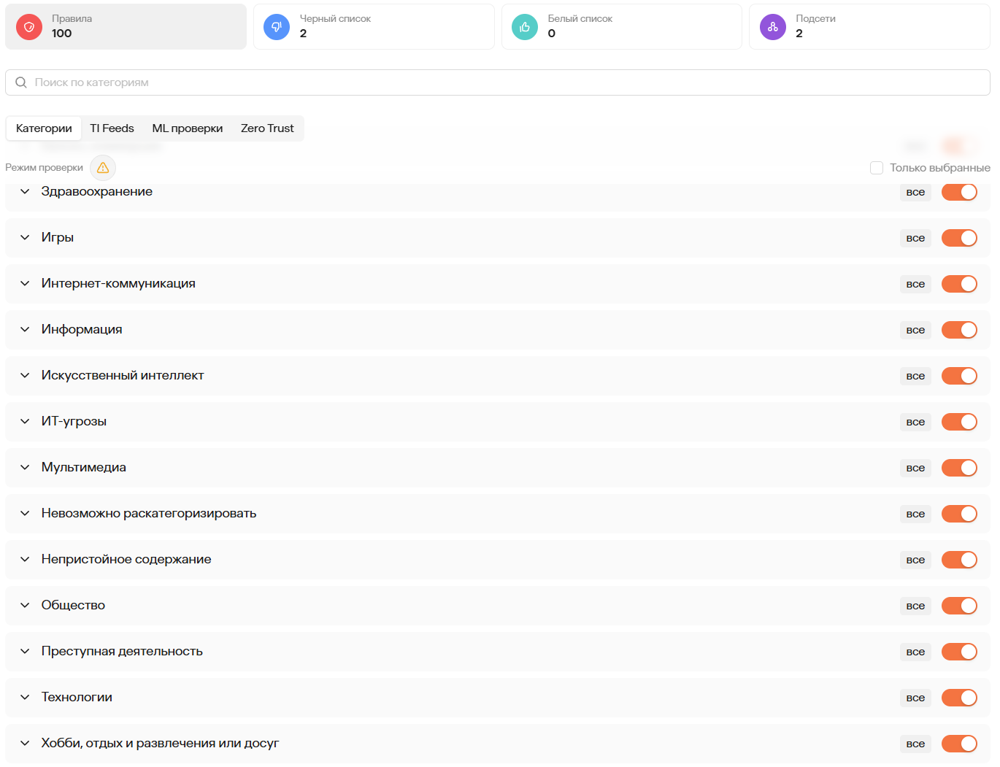
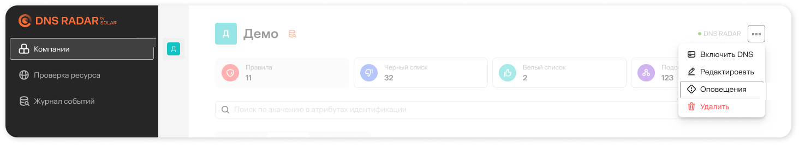
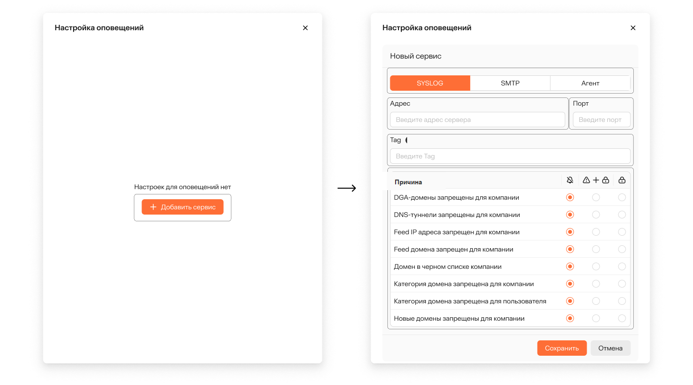
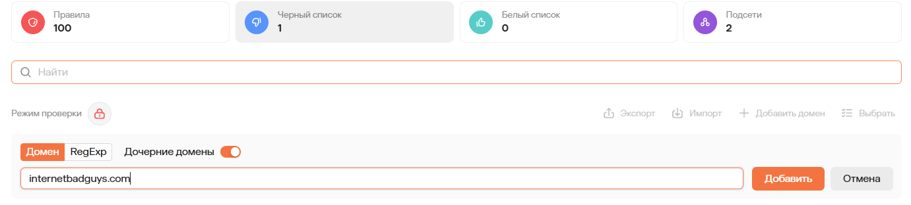
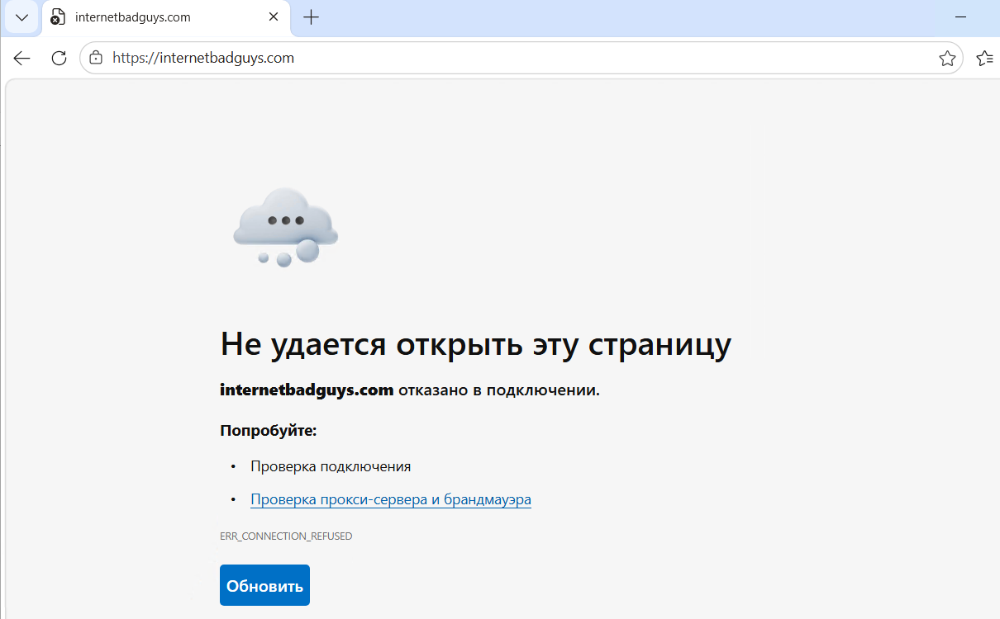
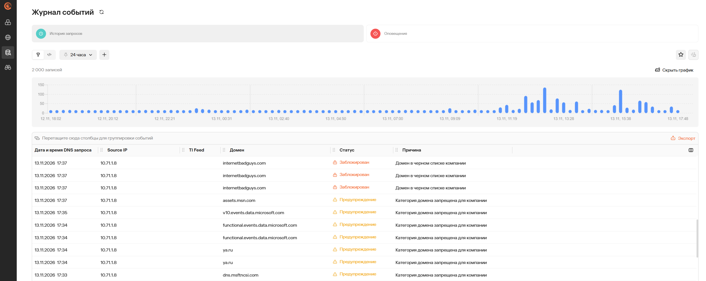
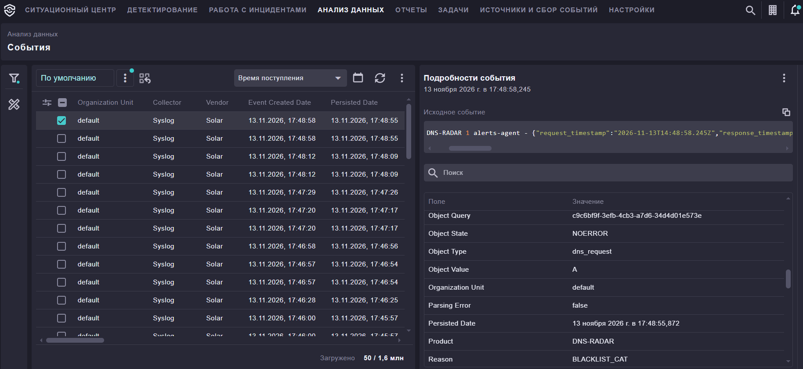

# Интеграция Solar DNS RADAR и Solar SIEM

Описание подключения Solar DNS RADAR, **развёрнутого в облаке**, и пересылку событий в Solar SIEM по протоколу syslog.

Локальный прокси фильтрует DNS-запросы по правилам платформы (чёрный/белый списки, категории, фиды, ML), а сервис alerts-agent пересылает события в SIEM по syslog.

## 1. Варианты подключения к DNS RADAR

- **Прокси за DNS-сервером заказчика** — DNS-сервер заказчика пересылает запросы на прокси, во внешний мир они уходят с EDNS-заголовками. Применяется на любых вариантах развертывания: on-premise, гибридном, облачном. **Этот вариант реализован в настоящей инструкции (разделы 2–6).**
- **Прокси сбоку** — на прокси перенаправляются запросы только части АРМов (настройка DNS передаётся по DHCP). Применим для on-premise и гибридного вариантов.
- **Прокси перед DNS-сервером заказчика** — запросы всех АРМов и серверов идут через прокси. Применим для on-premise и гибридного вариантов.

---

**Вариант 1. Прокси за DNS-сервером заказчика.**

Все клиенты обращаются к DNS-серверу заказчика, который пересылает запросы на прокси:

```text
АРМ → DNS-сервер заказчика → прокси RADAR → рекурсивный DNS → интернет
```

Настройки DNS-сервера заказчика:

- условные пересылки (forwarders) — только на IP прокси;
- локальные зоны обслуживаются сервером напрямую, минуя прокси;
- включить EDNS Client Subnet (ECS) — иначе прокси видит IP DNS-сервера вместо IP клиента;
- DHCP раздаёт клиентам адрес DNS-сервера заказчика.

!!! note
    В облачном варианте развертывания роль прокси выполняют публичные серверы DNS RADAR — они указываются как рекурсивные (forwarders) на DNS-серверах заказчика напрямую.

---


**Вариант 2. Прокси сбоку.**

Прокси стоит параллельно DNS-серверу заказчика; на прокси смотрят только выбранные АРМы (адрес DNS раздаётся по DHCP):

```text
выбранные АРМ → прокси RADAR → DNS-сервер заказчика → интернет
остальные АРМ → DNS-сервер заказчика
```

- upstreams прокси — DNS-серверы заказчика;
- гранулярность по хостам достигается настройкой DHCP (какие клиенты получают адрес прокси).

**Вариант 3. Прокси перед DNS-сервером заказчика.**

---


Прокси встаёт в разрыв перед DNS-сервером: запросы всех АРМов и серверов идут через прокси:

```text
все АРМ и серверы → прокси RADAR → DNS-сервер заказчика → интернет
```

- DHCP раздаёт клиентам адрес прокси (вместо адреса DNS-сервера);
- upstreams прокси — DNS-сервер заказчика.

## 2. Установка прокси

Требуется Docker. Образы прокси и alerts-agent распространяются через закрытый реестр контейнеров вендора — доступ к нему выдаётся вендором при подключении.

Создать каталог, например `/opt/dns-proxy` и файл `compose.yaml` (службу `alerts-agent` добавим на шаге 3):

```yaml
services:
  proxy:
    container_name: proxy
    image: registry.data.rt-solar.ru/4rays/secdns/proxy:v<версия>-public
    command: serve -c /config/proxy.pkl
    volumes:
      - "./proxy.pkl:/config/proxy.pkl:ro"
    network_mode: host
    restart: unless-stopped
    ulimits:
      nofile:
        soft: "65536"
        hard: "65536"
```

Создать `/opt/dns-proxy/proxy.pkl`:

```pkl
amends "../pkl/config.pkl"

debug = false
log_level = "info"

proxy_id = "<уникальный-id-прокси>"
build_version = "<актуальная версия>"
jwt = "<токен Control Center>"

health_server {
  host = "127.0.0.1"
  port = "82"
}

server {
  port = "53"
  monitor_port = "9102"
  amount_sockets = 4
  amount_ml_models = 1

  is_refused_on_not_found = false
  check_google_zip_net_for_tunnel = true

  private_addresses_ipv4 = List()
  private_addresses_ipv6 = List()

  forward {
    upstreams = List("195.208.4.1:53", "195.208.5.1:53")
    dns_client_read_timeout  = 10
    dns_client_write_timeout = 10
  }

  mlWhiteListSettings {
    domains = List("1e100.net", "in-addr.arpa")
  }

  cache {
    ttl = 30
  }

  rate_limiter {
    cache_size = 2097152
    record_ttl_sec = 60
    rps_by_client = 1000
    burst = 2000
  }

  sync_state {
    service_url = "grpc-sync-state.stage.secdns.envs.4rays.private:443"
    tls_enabled = true
  }

  sync_logs {
    service_url = "grpc-sync-state.stage.secdns.envs.4rays.private:443"
    tls_enabled = true
  }

  clientDomainManager {
    threshold_unique_subdomains = 8
    ttl_window = 300
    clean_internval = 60
  }
}
```

Ключевые поля:

| Поле | Назначение |
|------|------------|
| `proxy_id` | идентификатор прокси (выдаётся вместе с JWT) |
| `build_version` | версия сборки образа — обязателен, должен совпадать с версией образа |
| `jwt` | токен подключения к Control Center |
| `server.port` | порт прослушивания DNS-запросов |
| `forward.upstreams` | корпоративные рекурсивные DNS — конечная точка рекурсии |
| `mlWhiteListSettings.domains` | домены, исключённые из ML-анализа |
| `cache.ttl` | время кэширования ответов, сек |
| `rate_limiter` | ограничение частоты запросов с одного клиента (`rps_by_client`, `burst`) |
| `clientDomainManager` | детект DNS-туннелей: порог уникальных поддоменов (`threshold_unique_subdomains`) за окно `ttl_window` |
| `sync_state` / `sync_logs` | облако DNS RADAR: синхронизация правил и отправка журнала запросов |

## 3. Установка alerts-agent и пересылка по протоколу syslog в SIEM

alerts-agent добавляется второй службой в тот же файл `compose.yaml`, где находится `proxy`, на том же уровне вложенности (в примере это `/opt/dns-proxy/compose.yaml`) :

```yaml
  alerts-agent:
    container_name: alerts-agent
    image: registry.data.rt-solar.ru/4rays/secdns/alerts-agent:v<версия>-public
    network_mode: host
    restart: unless-stopped
    environment:
      - SYSLOG_AGENT_TRANSPORT_ADDRESS=<адрес облака DNS RADAR>:443
      - SYSLOG_AGENT_TRANSPORT_TLS_ENABLED=true
      - SYSLOG_AGENT_TRANSPORT_TOKEN=<jwt>
      - SYSLOG_AGENT_SYSLOG_SERVERS=udp://<адрес-коллектора-siem>:5051
    ulimits:
      nofile:
        soft: "65536"
        hard: "65536"
```

Переменные окружения:

| Переменная | Назначение |
|------|------|
| `SYSLOG_AGENT_TRANSPORT_ADDRESS` | облако DNS RADAR (`sync-alerts`): агент подключается наружу по TLS, входящие порты не требуются |
| `SYSLOG_AGENT_TRANSPORT_TOKEN` | тот же токен, что в `proxy.pkl` |
| `SYSLOG_AGENT_SYSLOG_SERVERS` | приёмник syslog в SIEM: адрес коллектора и порт |

Агент шлёт события с IP хоста (`network_mode: host`) — в SIEM источником будет этот адрес.

!!! note
    **5051 — порт syslog-коллектора SIEM по умолчанию**, если для точки сбора не задан переопределённый порт.

## 4. Настройка коллектора в SIEM

- Перейти на квладку **Источники и сбор событий → Коллекторы** и создать коллектор с типом **Syslog**:



- На вкладке **Нормализаторы** включить нормализатор **Syslog Solar DNS RADAR** (поставляется в комплекте SIEM). Нормализатор должен располагаться выше `Default Normalizer Syslog`.



## 5. Настройка правил в DNS RADAR

Правила создаются в консоли DNS RADAR в разделе **Правила** (уровень компании/тенанта). Сводка по активным правилам выводится карточками: **Правила**, **Чёрный список**, **Белый список**, **Подсети**.



Основные инструменты раздела:

- **Категории** — готовые группы ресурсов (ИТ-угрозы, Непристойное содержание, Мультимедиа и т.д.). Категория или отдельная группа включается переключателем; режим проверки (блокировка/предупреждение) задаётся рядом;
- **TI Feeds** — подключаемые каналы данных об угрозах;
- **ML-проверки** и **Zero Trust** — дополнительные механизмы анализа (новые/малоизвестные домены).

### Оповещения для агента

Чтобы события о срабатываниях правил попадали в alerts-agent, в консоли DNS RADAR нужно создать правило оповещений:

- Перейти в **Компания** → меню **«...»** → **Оповещения**.



- Нажать **Добавить сервис** и выбрать тип доставки **Агент** — дополнительные параметры (IP, порты) не задаются: агент сам подключается к облаку по HTTPS (настраивается в `compose.yaml` на хосте с прокси, раздел 3).
- Выбрать **Причины** оповещений — например, «Домен в черном списке компании» — и режим: **Оповещать при блокировке** или **Оповещать при блокировке и обнаружении**.



- Для проверки нажать **Тест** — придёт пробное уведомление; отправка включается переключателем рядом с правилом.

Агент принимает уведомления по защищённому протоколу (VPN-туннель не требуется) и пересылает их по syslog в SIEM (раздел 3). Без созданного правила оповещений события в SIEM не доставляются.

### Чёрный список

Самый быстрый способ проверить фильтрацию — добавить домен в **Чёрный список**:

- Открыть вкладку **Чёрный список** и нажать **Добавить домен**.
- Указать домен (например, `internetbadguys.com`) и выбрать тип записи `Domain`; поддерживается также `RegExp`.
- Опция **«Дочерние домены»** распространяет правило на все поддомены.
- Выбрать режим: **Блокировать** или **Предупреждать**.



Список можно переносить между инсталляциями кнопками **Экспорт**/**Импорт** (JSON).

!!! note
    Правила действуют на всю компанию (тенант). Гранулярность по хостам достигается только подсетями: раздел **Подсети** позволяет выделить группу адресов, а отдельные правила — через отдельные тенанты.

!!! note
    Порядок применения: сначала проверяется **Белый список** (разрешает в обход остальных правил), затем **Чёрный список**, затем категории, фиды и ML.

## 6. Запуск и проверка

Команды выполняются на хосте, где поднят прокси (раздел 2):

```bash
cd /opt/dns-proxy
docker compose up -d
docker compose logs -f
```

В логах при успешном старте обоих контейнеров должны отсутствовать ошибки.

- Убедиться, что тестовый домен добавлен в **Чёрный список** (см. раздел 5). Для теста используем домен `internetbadguys.com`. Прокси забирает правило автоматически (обычно в течение минуты):

- Открыть `internetbadguys.com` в браузере на клиенте — соединение отклоняется:



- Проверить доставку событий: запись в **Журнале событий** RADAR и событие в SIEM.

Пример срабатывания чёрного списка в **Журнале событий** RADAR: запросы к `internetbadguys.com` со статусом **Заблокирован**, причина — «Домен в черном списке компании»:



Событие о блокировке, доставленное alerts-agent в SIEM, причина `BLACKLIST_CAT` — нормализатор **Syslog Solar DNS RADAR** разобрал исходное syslog-сообщение в поля:


